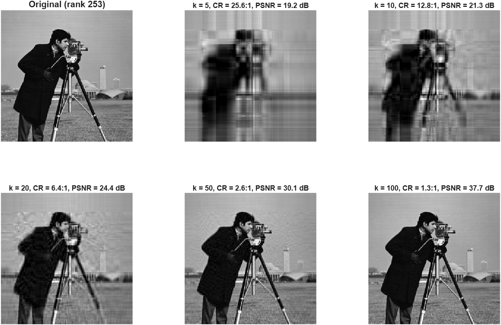
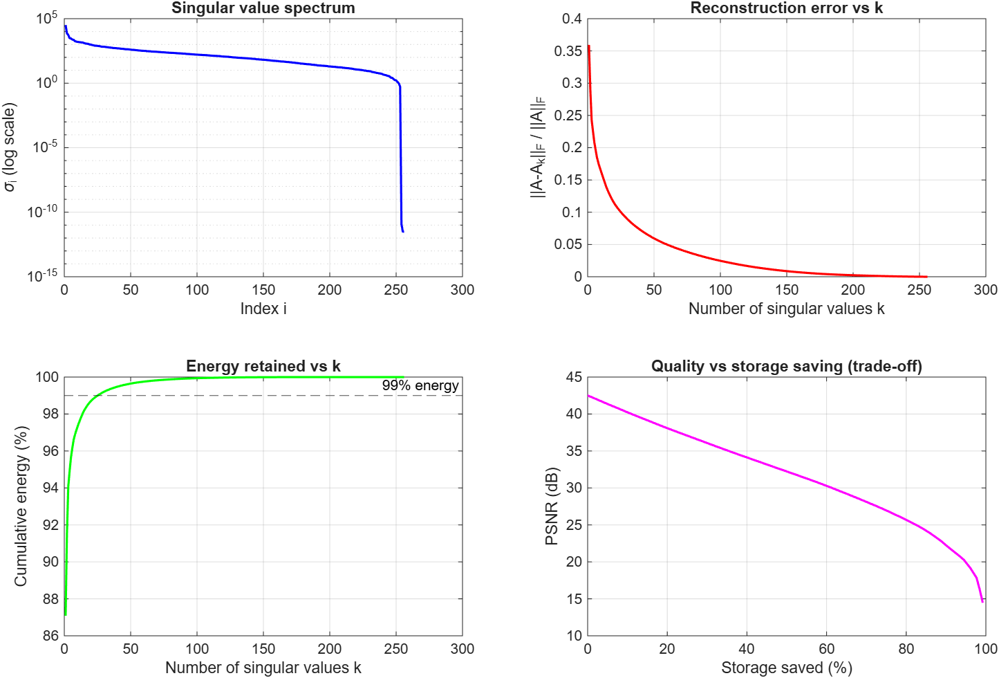
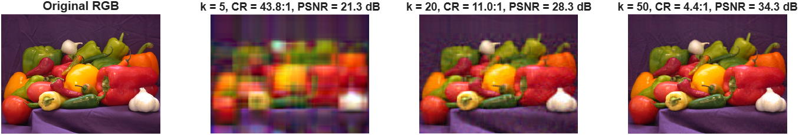
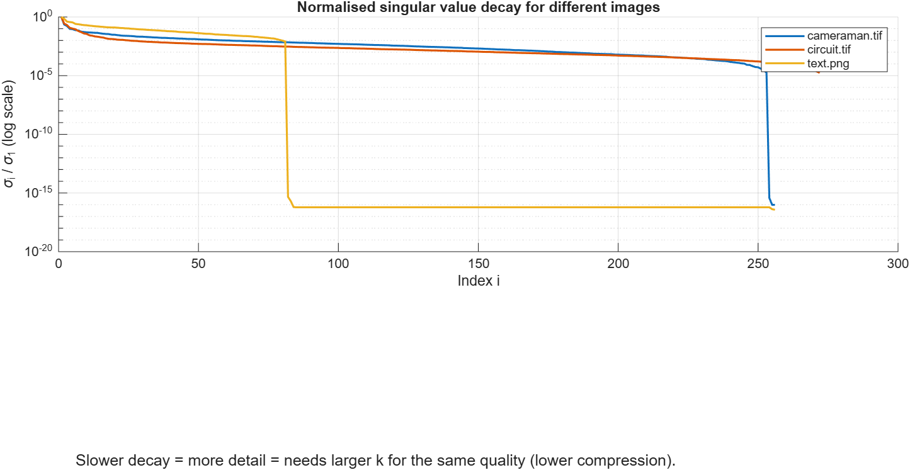

# Image Compression using Singular Value Decomposition (SVD)

Mini project for **Mathematics for Computing**, Manav Rachna International Institute of Research and Studies (MRIIRS).

This MATLAB project compresses images by keeping only the largest singular values of the image matrix, then measures how much storage is saved and how much quality is lost.

## How SVD compression works

A grayscale image is an `m × n` matrix `A` of pixel values. SVD factorises it as

```
A = U Σ Vᵀ
```

where `U` and `V` have orthonormal columns and `Σ` is diagonal with the singular values `σ₁ ≥ σ₂ ≥ … ≥ 0`.

Keeping only the first `k` singular values gives the rank-k approximation

```
A_k = σ₁ u₁ v₁ᵀ + σ₂ u₂ v₂ᵀ + … + σ_k u_k v_kᵀ  =  Σ_{i=1..k} σᵢ uᵢ vᵢᵀ
```

- **Storage:** the original needs `m·n` numbers; `A_k` needs only `k·(m + n + 1)`.
- **Compression ratio:** `CR = m·n / (k·(m + n + 1))`.
- **Error:** by the Eckart–Young theorem, `A_k` is the best rank-k approximation, with
  `‖A − A_k‖_F = √(σ_{k+1}² + … + σ_p²)`.

Most of an image's "energy" sits in the first few singular values, so a small `k` already looks close to the original.

## Features

| Section | What it does | Syllabus unit |
|---|---|---|
| 1–2 | Loads the image and treats it as a matrix | Unit 1: Matrices |
| 3 | Computes the SVD, the rank, and checks `σᵢ = √eig(AᵀA)` | Units 1–2: Rank, Eigenvalues, SVD |
| 4–5 | Builds rank-k approximations; computes storage, compression ratio, relative error and PSNR | Unit 2 |
| 6 | Shows the original next to k = 5, 10, 20, 50, 100 | |
| 7 | Plots singular value spectrum, error vs k, energy vs k, quality vs storage | |
| 8 | Verifies the Eckart–Young theorem and finds the smallest k with ≤ 5% error | Unit 5: Optimization |
| 9 | **Extra:** colour (RGB) compression, one SVD per channel | |
| 10 | **Extra:** compares several test images by singular value decay | |
| 11 | **Extra:** interactive slider to change k live | |

The script opens **five figures**: Original vs Compressed, Error Analysis, Colour compression, Image comparison, and the Interactive slider. It also prints a results table in the Command Window.

## Requirements

- MATLAB **R2022a** or later
- **Image Processing Toolbox**

## How to run

1. Download or clone this repository.
2. Open MATLAB and set the current folder to the repository folder.
3. Open `svd_image_compression.m` and press **Run** (F5).
4. Close the slider window when you are done.

The script looks for each image in this order:

1. the `images/` folder next to the script,
2. the sample images that ship with the Image Processing Toolbox (`cameraman.tif`, `circuit.tif`, `text.png`, `peppers.png`),
3. if neither is found, a file picker asks you to choose an image.

So with the toolbox installed it runs as-is. To try your own pictures, put them in `images/` using those file names.

## Folder structure

```
MFC_SEM1_PROJECT/
├── svd_image_compression.m   # main script (run this)
├── images/                   # optional: your own test images
├── results/                  # screenshots of the output figures
├── README.md
├── LICENSE
└── .gitignore
```

## Results

<!-- Replace these with your own screenshots saved in the results/ folder -->

| Original vs Compressed | Error Analysis |
|---|---|
|  |  |

| Colour compression | Image comparison |
|---|---|
|  |  |


## Author

- **Name:** _Your Name_
- **Roll No.:** _Your Roll Number_
- **Course:** Mathematics for Computing, MRIIRS

## License

This project is released under the [MIT License](LICENSE).
